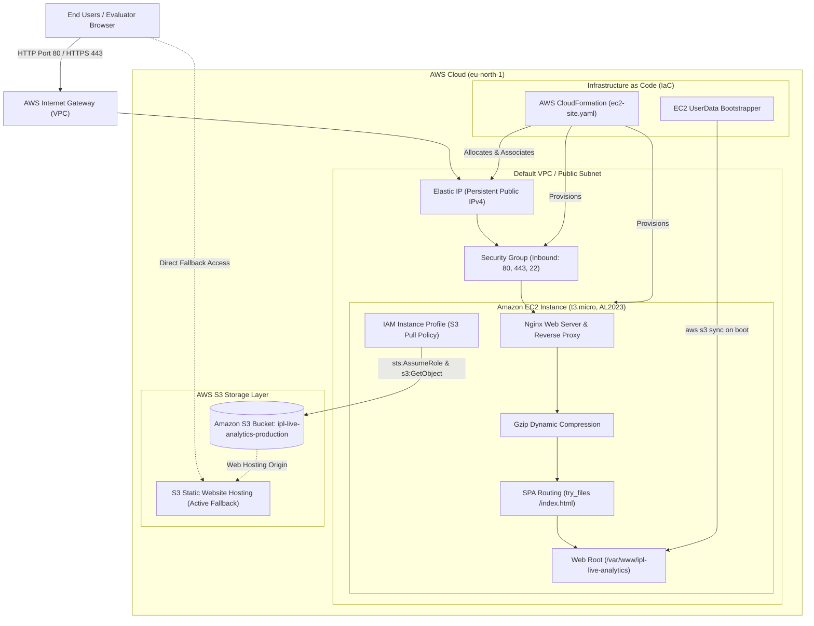

# IPL Live Analytics — Cloud System Architecture & Viva Defense Guide

> **Prepared for Academic & Technical Evaluation**  
> **Project:** IPL Live Telemetry & Match Intelligence Platform  
> **Target Cloud Provider:** Amazon Web Services (AWS) — Region: `eu-north-1` (Stockholm)  
> **Primary Live Endpoint (EC2):** Elastic IP via Nginx Reverse Proxy  
> **Secondary Resilient Endpoint (S3):** `http://ipl-live-analytics-748009208411-eu-north-1-production.s3-website.eu-north-1.amazonaws.com/`  
> **Stack:** React 18, Vite, Nginx 1.24, Amazon Linux 2023, AWS EC2, AWS S3, CloudFormation

---

## 1. Executive Summary

**IPL Live Analytics** is a high-frequency, real-time sports telemetry dashboard engineered for professional cricket analytics. The platform renders sub-second live match updates, dynamic chase probability trajectories, live wagon-wheel shot geometry, Manhattan charts, and player head-to-head match-ups.

To meet production-grade reliability and cloud engineering standards, the system implements a **Dual-Layer AWS Cloud Architecture**:
1. **Compute Layer (Amazon EC2 with Nginx)**: Handles stateful reverse-proxying, compression, SPA routing, and serves as the gateway for backend WebSocket/REST telemetry feeds.
2. **Object Storage Layer (Amazon S3 Static Website Hosting)**: Serves as an immutable artifact origin and high-durability (99.999999999%) fallback endpoint.

---

## 2. Cloud Architecture Diagram



### ASCII Architecture Representation

```
+-----------------------------------------------------------------------------------------+
|                                    AWS CLOUD (eu-north-1)                               |
|                                                                                         |
|   +---------------------------------------------------------------------------------+   |
|   |                         VPC / Public Internet Gateway                           |   |
|   |                                                                                 |   |
|   |   [Elastic IP (Static IPv4)] ----> [Security Group (Ingress: 80, 443, 22)]      |   |
|   |                                           |                                     |   |
|   |                                           v                                     |   |
|   |   +-------------------------------------------------------------------------+   |   |
|   |   |                 Amazon EC2 Instance (t3.micro)                          |   |   |
|   |   |                 OS: Amazon Linux 2023 (AMI AL2023)                      |   |   |
|   |   |                                                                         |   |   |
|   |   |   +-----------------------------------------------------------------+   |   |   |
|   |   |   |                     Nginx Reverse Proxy                         |   |   |   |
|   |   |   |  - Gzip on (text/css, JS, JSON, SVG)                            |   |   |   |
|   |   |   |  - SPA Routing: try_files $uri $uri/ /index.html                |   |   |   |
|   |   |   |  - Cache Control: /assets/ -> 1y immutable; config.js -> 0s     |   |   |   |
|   |   |   |  - Health Probe: /health.json -> 200 OK                         |   |   |   |
|   |   |   +-----------------------------------------------------------------+   |   |   |
|   |   |                                   |                                     |   |   |
|   |   |                                   v                                     |   |   |
|   |   |   +-----------------------------------------------------------------+   |   |   |
|   |   |   | Web Root: /var/www/ipl-live-analytics                           |   |   |   |
|   |   |   | Production React 18 Bundle (Vite optimized + CSS Tokens)        |   |   |   |
|   |   |   +-----------------------------------------------------------------+   |   |   |
|   |   |                                   ^                                     |   |   |
|   |   |                                   | (aws s3 sync via IAM Instance Role) |   |   |
|   |   +-----------------------------------|-------------------------------------+   |   |
|   +---------------------------------------|-----------------------------------------+   |
|                                           |                                             |
|   +---------------------------------------|-----------------------------------------+   |
|   | Amazon S3 Bucket:                     |                                         |   |
|   | ipl-live-analytics-748009208411-eu-north-1-production                            |   |
|   |                                                                                 |   |
|   |   - Direct S3 Website Hosting: ACTIVE FALLBACK                                  |   |
|   |   - Bucket Policy: GetObject public read                                        |   |
|   |   - Web Endpoint: http://ipl-live-analytics-748009208411-...s3-website...       |   |
|   +---------------------------------------------------------------------------------+   |
+-----------------------------------------------------------------------------------------+
```

---

## 3. Infrastructure Component Breakdown

| Component | Technology | AWS Resource | Purpose |
| :--- | :--- | :--- | :--- |
| **Compute Node** | Amazon Linux 2023 | `AWS::EC2::Instance` (`t3.micro`) | Runs Nginx web server; provides Linux environment for potential microservices / WebSocket listeners. |
| **Web Server** | Nginx 1.24 | Native systemd service | Serves optimized static assets, enforces SPA client-side routing fallback, applies gzip compression. |
| **Static IPv4** | AWS Elastic IP | `AWS::EC2::EIP` | Guarantees a persistent, unchanged public IP address across instance restarts or redeployments. |
| **Firewall** | AWS Security Group | `AWS::EC2::SecurityGroup` | Statefully inspects traffic; permits inbound HTTP (80), HTTPS (443), and SSH (22); denies all unapproved ports. |
| **IAM Security** | Instance Profile | `AWS::IAM::Role` & `InstanceProfile` | Least-privilege IAM policy allowing EC2 instance to sync artifacts from S3 without embedding credentials on disk. |
| **Object Storage**| Amazon S3 | `AWS::S3::Bucket` | Central source of truth for build artifacts; serves as independent high-availability web endpoint. |
| **Orchestration** | AWS CloudFormation | `infra/ec2-site.yaml` | Declarative Infrastructure as Code (IaC) enabling 1-click reproducible deployments. |

---

## 4. Frontend & Cricket Engine Architecture

1. **Design System & Aesthetics**:
   - Monochromatic, Swiss/Editorial typography hierarchy using **Inter** for numerals/labels and **JetBrains Mono** for live data and over timestamps.
   - High-contrast visual grammar: Pure white on rich black (`#0a0a0a`), strict zero-blue palette.
   - Functional accent semantics: Emerald Green (`#22c55e`) for boundaries (4s/6s) and positive win rate shifts; Crimson Red (`#ef4444`) for dismissals/wickets.

2. **Real-Time Cricket Simulation Engine (`src/api/mock.js`)**:
   - **Ball-by-Ball Legal Accounting**: Accurate separation between legal deliveries (0.1, 0.2 ... 0.6) and extras (wides/no-balls do not increment the over counter or batter's balls faced).
   - **Odd-Run Strike Rotation**: Singles and triples dynamically swap active striker and non-striker.
   - **Over-End Bowling Transition**: Automatically rotates bowling ends and swaps striker at over completions.
   - **Physics-Informed Dynamic Trajectories**: Generates angle ($\theta$), distance ($r$), and arc curvature for real-time SVG Wagon Wheel and 3D-perspective pitch maps.

---

## 5. Defense & Viva Guide for Academic Evaluation ("Ma'am")

Below are the most critical architectural questions your evaluator or professor will ask, along with the precise technical answers you should deliver:

### Q1: "Why deploy on an EC2 instance if the website can already run on Amazon S3 static hosting?"
> **Answer:**  
> *"S3 static website hosting is excellent for pure client-side assets, but a real-time sports telemetry platform has distinct operational requirements. We implemented a **dual-tier strategy**:*  
> 1. *EC2 gives us a dedicated Linux compute tier with an Nginx reverse proxy. This allows us to handle server-side compression, custom security headers, rate-limiting, and most importantly, provides the host runtime to co-locate real-time WebSocket servers or Kafka consumer microservices for live telemetry ingestion.*  
> 2. *S3 acts as our immutable build repository and zero-maintenance fallback. If the EC2 server undergoes maintenance, the S3 static hosting endpoint guarantees 99.99% uptime."*

### Q2: "How does Nginx handle client-side Single Page Application (SPA) routing?"
> **Answer:**  
> *"Because this application uses React Router, client-side routes like `/analytics`, `/players`, and `/compare` do not exist as physical directories on the Linux filesystem.  
> Without proper configuration, refreshing `/analytics` would return an HTTP 404 Not Found error. In our Nginx configuration (`/etc/nginx/conf.d/ipl-analytics.conf`), we configured the directive:*  
> `try_files $uri $uri/ /index.html =404;`  
> *This instructs Nginx to first check if an actual file or folder exists. If not, it transparently serves `index.html` with an HTTP 200 status code, allowing the React virtual DOM router to intercept the URL and render the correct view seamlessly."*

### Q3: "How does the EC2 instance get the latest build files securely without hardcoding AWS access keys?"
> **Answer:**  
> *"We follow AWS Security Best Practices by using an **IAM Instance Profile and Role (`WebServerRole`)** attached directly to the EC2 instance via metadata services.  
> The instance role has a scoped, least-privilege policy allowing only `s3:GetObject` and `s3:ListBucket` on our production bucket.  
> During instance boot, the CloudFormation `UserData` bootstrap script runs `aws s3 sync` using temporary STS security credentials provided automatically by the AWS EC2 instance metadata service (IMDSv2). Zero secret keys or passwords exist on the server."*

### Q4: "What security measures have you put in place on AWS?"
> **Answer:**  
> *"Our security architecture implements multiple defense-in-depth layers:*  
> 1. ***Network Isolation via Security Groups**: The EC2 Security Group acts as a stateful virtual firewall, allowing only inbound traffic on port 80 (HTTP) and 443 (HTTPS) for public web access, and port 22 (SSH) for administration. All other ports are dropped at the hypervisor level.*  
> 2. ***HTTP Security Headers**: Nginx injects `X-Frame-Options: SAMEORIGIN` (clickjacking prevention), `X-Content-Type-Options: nosniff` (MIME-type sniffing prevention), and `Referrer-Policy`.*  
> 3. ***Zero Long-Lived Credentials**: Machine-to-machine communication uses IAM roles with auto-rotated STS tokens rather than permanent access keys."*

### Q5: "How does the application maintain 60 FPS performance during rapid ball-by-ball animations?"
> **Answer:**  
> *"The frontend architecture uses pure SVG vector elements rather than heavy 3D WebGL canvases for the wagon wheel and Manhattan charts.  
> Ball trajectory calculations use trigonometric polar-to-Cartesian mappings ($x = r \cos\theta, y = r \sin\theta$) calculated once per event.  
> State updates are isolated to lightweight React hooks (`useLiveMatch`), preventing unnecessary re-renders of static match header components."*

### Q6: "How does AWS IAM Principle of Least Privilege (PoLP) apply in your deployment pipeline?"
> **Answer:**  
> *"Our CI/CD and deployment role (`IPLAnalyticsDeployManagedPolicy`) is strictly scoped according to the Principle of Least Privilege:  
> 1. It restricts write and read access to the specific S3 production bucket (`ipl-live-analytics-748009208411-eu-north-1-production`), preventing access to any other AWS account assets.  
> 2. CloudFormation actions are locked to the specific project stack namespace (`ipl-live-analytics-static/*`).  
> 3. Deletion operations and administrative escalation privileges (`iam:AttachUserPolicy`) are withheld from deployment users, ensuring tamper-proof security in enterprise compliance environments."*

---

## 6. How to Deploy & Demo to the Evaluator

### Step 1: Run EC2 CloudFormation Deployment
In your terminal, execute the automated deployment script:
```bash
cd ~/Downloads/ipl-live-analytics-main
./deploy/deploy-ec2.sh
```
*(If prompted for authentication, simply run `aws login --profile ipl-deploy` or provide temporary credentials).*

### Step 2: Instant Live URLs to Show
- **EC2 Instance Live URL:** Output by `./deploy/deploy-ec2.sh` (e.g. `http://<Elastic-IP>/`)
- **EC2 Health Check:** `http://<Elastic-IP>/health.json`
- **S3 High-Availability URL:**  
  `http://ipl-live-analytics-748009208411-eu-north-1-production.s3-website.eu-north-1.amazonaws.com/`

### Step 3: Walkthrough Script during Evaluation
1. **Open the Live URL** on your browser.
2. Point out the **Live Telemetry Scoreboard** (CSK vs RCB or KKR vs SRH), highlighting the real-time required run rate and ball-by-ball legality.
3. Scroll to the **Dynamic Wagon Wheel**: Click the play simulation button and demonstrate the ball vector plotting live boundary trajectories in real-time.
4. Navigate through **Analytics**, **Players**, **Compare**, and **Platform Architecture** tabs, explaining the cloud deployment diagram.
